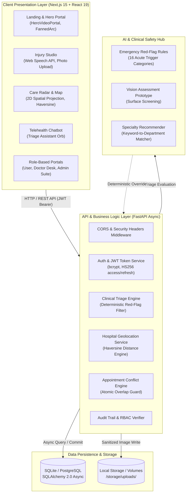
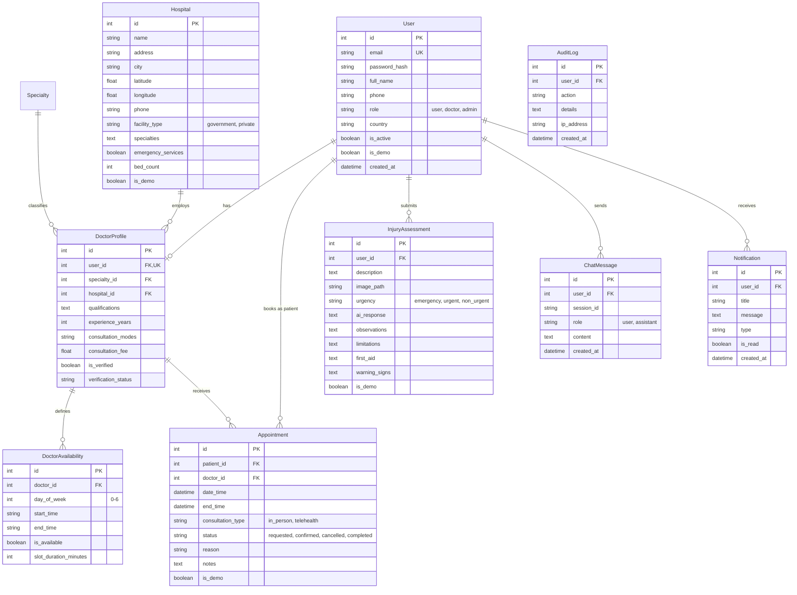
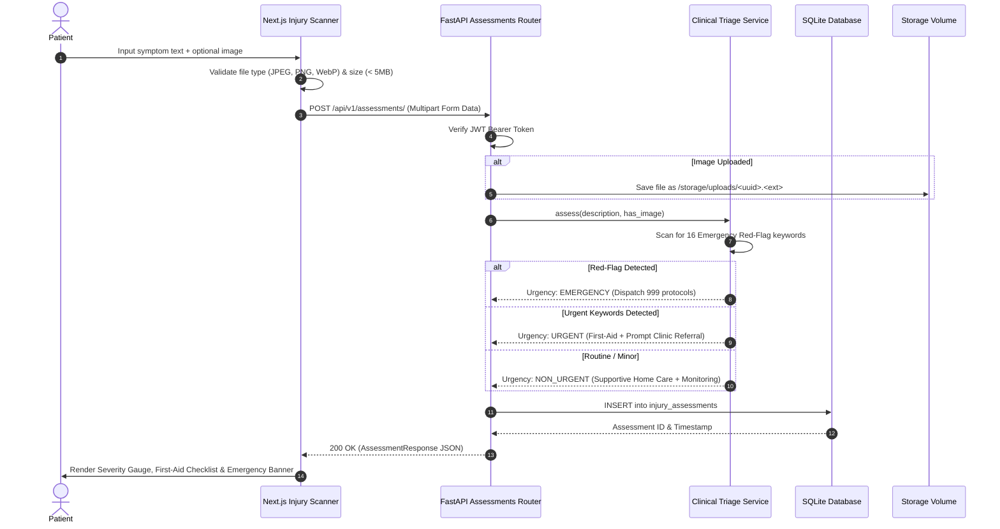
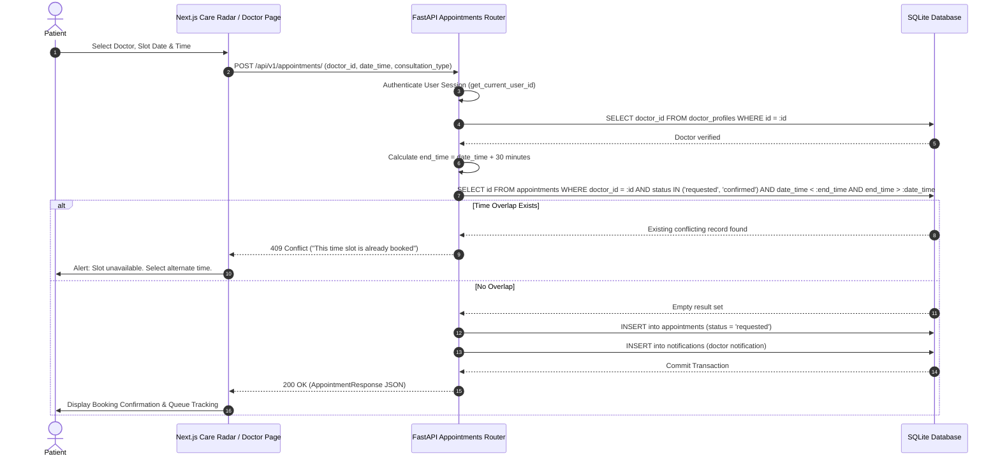

# Medinexa AI — System Architecture & Technical Specification

## 1. System Overview & Architectural Objectives

Medinexa AI is a modular digital health platform engineered to bridge acute first-aid triage, emergency facility discovery, verified doctor appointments, and telehealth consultation triage. The system is designed with a strict **Safety-First Principle**: automated AI screening must never replace qualified emergency responders or make unverified clinical diagnoses.

### Key Architectural Tenets
1. **Deterministic Safety Primacy**: Life-threatening symptoms immediately trigger emergency response protocols (**Bangladesh 999** dispatch instructions) and bypass probabilistic AI inference.
2. **Decoupled Client-Server Modularity**: A high-performance Next.js 15 App Router frontend communicates via typed REST APIs with an asynchronous FastAPI backend.
3. **Strict Role Isolation (RBAC)**: Enforced authorization barriers between Patients/Users, Doctors, and Platform Administrators.
4. **Data Integrity & Concurrency**: Atomic slot conflict validation prevents double-booking for physician appointments.
5. **Geospatial Precision**: Geodesic distance sorting using the Haversine formula for nearby healthcare facility discovery.

---

## 2. System Architecture Diagram

---

## 3. Layered Architectural Decomposition

### 3.1 Client Presentation Layer (`frontend/`)
The frontend is built on **Next.js 15.5.0** and **React 19.1.0** utilizing the App Router architecture:
- **Client Providers (`frontend/src/components/ui/ClientProviders.jsx`)**: Envelops the application with global state contexts (`AuthProvider`, `LocationProvider`) and notification toast handlers (`react-hot-toast`).
- **Authentication Context (`frontend/src/context/AuthContext.jsx`)**:
  - Handles JWT access/refresh token persistence in browser `localStorage`.
  - Automatically recovers active user sessions on mount via `/api/v1/auth/me`.
  - Integrates an Axios response interceptor that transparently requests new access tokens via `/api/v1/auth/refresh` upon encountering HTTP 401 Unauthorized responses.
- **Location Context (`frontend/src/context/LocationContext.jsx`)**:
  - Leverages browser `navigator.geolocation` for real-time latitude/longitude coordinates.
  - Automatically falls back to Dhaka metropolitan coordinates (`23.8103° N, 90.4125° E`) when location permissions are denied.
- **Component Hierarchy**:
  - `HeroVideoPortal.jsx` & `FannedFeatureArc.jsx`: Responsive landing page visualization.
  - `InjuryScanner.jsx`: Multimodal intake supporting speech dictation (Web Speech API) and image attachments.
  - `SpatialCareRadar.jsx`: 2D spatial coordinate mapping of hospitals based on bounding latitude/longitude boundaries.
  - `TriageChatbot.jsx`: Streaming-like conversational chat interface with medical red-flag detection.
  - `DoctorWorkspace.jsx`, `AdminWorkspace.jsx`, `DashboardWorkspace.jsx`: Role-segregated management dashboards.

### 3.2 Backend Service Layer (`backend/app/`)
The backend is structured around **FastAPI** with asynchronous request processing:
- **Application Lifespan (`lifespan` in `app/main.py`)**: Automatically initializes database schemas and tables on server startup.
- **Dependency Injection**:
  - `get_db`: Yields an `AsyncSession` per request and ensures proper resource disposal.
  - `get_current_user_id`: Enforces HTTP Bearer JWT authentication, extracts the user `sub`, and rejects invalid or expired tokens.
  - `require_admin`: Server-side authorization check verifying that `user.role == 'admin'`.

### 3.3 Clinical Triage & AI Layer (`ml/` & `backend/app/services/`)
- **Emergency Filter**: Checks symptom descriptions against **16 acute emergency categories**:
  - Uncontrolled hemorrhage / arterial bleeding
  - Cardiac distress / crushing chest pain
  - Stroke indicators (facial drooping, slurred speech, acute paralysis)
  - Loss of consciousness / coma / convulsions / seizures
  - Airway obstruction / respiratory failure
  - Poisoning / severe overdose / anaphylaxis
- **Urgent Filter**: Evaluates 9 urgent clinical indicators (suspected fractures, deep lacerations, sustained high fevers > 39°C) and recommends clinical consultation within 6–12 hours.
- **Vision Prototype (`ml/injury_assessment/model.py`)**: Demonstrates multimodal screening capability with clear disclosure that visual analysis is a prototype not yet clinically validated.

---

## 4. Database Architecture & Entity Relationships

The data model is implemented using **SQLAlchemy 2.0 Async ORM** targeting SQLite (`sqlite+aiosqlite`) for local development and extensible to PostgreSQL.

---

## 5. Key Interaction Sequences

### 5.1 Multimodal Injury Triage Flow

### 5.2 Atomic Appointment Booking with Collision Prevention

---

## 6. Security & Healthcare Compliance

| Security Dimension | Mechanism Implemented | Audit Status |
|---|---|---|
| **Authentication** | JSON Web Tokens (`HS256`), access token (30 min) + refresh token (7 days) | Verified |
| **Password Hashing** | One-way `bcrypt` salting and hashing (`bcrypt.hashpw`) | Verified |
| **Role-Based Guards** | Server-side dependency `require_admin` on all `/admin/*` operations | Verified |
| **Schedule Integrity** | Mathematical overlap check (`start1 < end2 AND end1 > start2`) | Verified |
| **Input Sanitization** | Pydantic v2 validation models on all incoming payloads | Verified |
| **Upload Constraints** | Restricted MIME types (`image/jpeg`, `image/png`, `image/webp`), 5MB cap | Verified |
| **Clinical Transparency** | Explicit disclaimer banners, non-clinical tags, and emergency 999 overrides | Verified |
| **Audit Trail** | System-wide audit log table tracking administrative actions | Verified |
